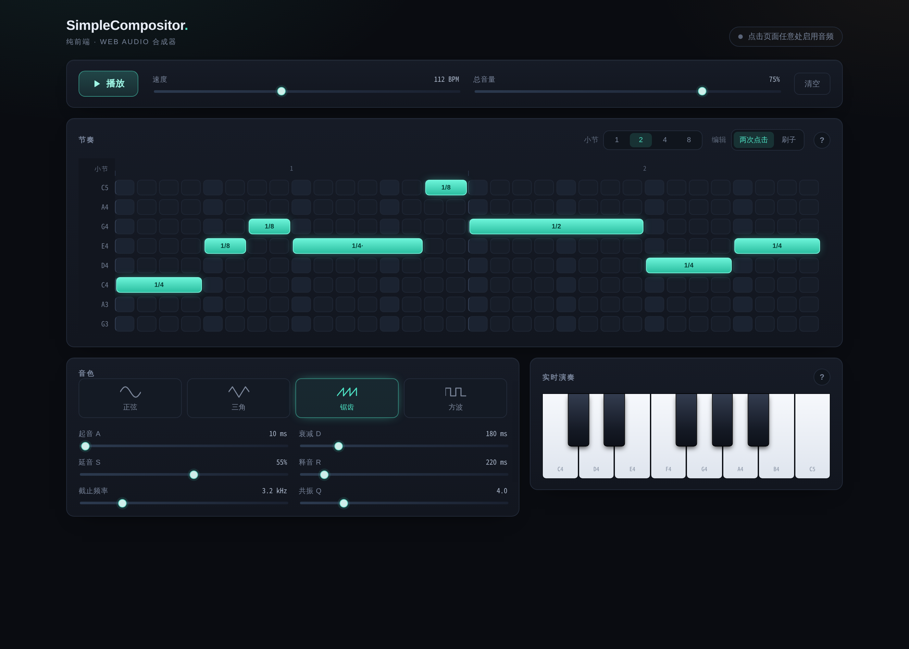

# SimpleCompositor

一个纯前端的浏览器合成器：16 步节奏网格 + 四种基本波形 + 实时演奏键盘。
零音频依赖，全部基于浏览器原生 Web Audio API。



## 运行

```bash
npm install
npm run dev        # 监听 0.0.0.0:5173
npm run build      # tsc 类型检查 + vite build
npm run preview
```

## 功能

- **波形**：正弦 / 三角 / 锯齿 / 方波
- **节奏**：16 步十六分音符音序器，BPM 50–200，循环播放
- **音色**：每个音 2 个 ±7 音分失谐振荡器 + ADSR 包络 + 低通滤波（截止频率 / 共振 Q）
- **复音**：主总线压缩器，多声部叠加不削顶
- **实时演奏**：C4–C5 键盘，按住持续发声，松开释放
- **快捷键**：空格键播放 / 停止

## 结构

音频全部跑在 React 之外：

| 文件 | 职责 |
| --- | --- |
| [`src/audio/engine.ts`](src/audio/engine.ts) | AudioContext 单例 + 主总线（压缩器 → 总音量） |
| [`src/audio/voice.ts`](src/audio/voice.ts) | 单音构建：振荡器 → 滤波 → ADSR |
| [`src/audio/scheduler.ts`](src/audio/scheduler.ts) | lookahead 步进调度器 |
| [`src/hooks/useTransport.ts`](src/hooks/useTransport.ts) | 把调度器接到 React，只管 UI 高亮 |
| [`src/components/`](src/components) | 纯展示组件 |

## 自检

```bash
npm run dev
# 然后打开 http://localhost:5173/dev/verify.html
```

页面用 `OfflineAudioContext` 离线渲染各波形，输出峰值、首尾采样、最大相邻采样差，
并验证调度器间隔是否等于 `60 / bpm / 4`。

## 路线

- 钢琴音色（采样）
- 混响 / 延迟效果器
- 步数切换（8 / 16 / 32）、多小节、swing
- Web MIDI 外接键盘
- 频谱可视化（`AnalyserNode`）
- 导出 WAV
